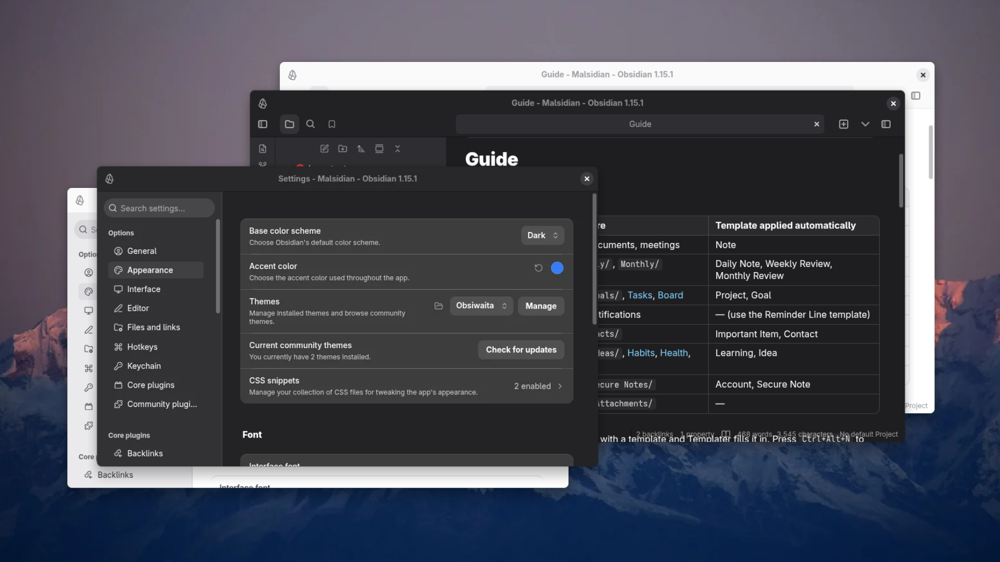
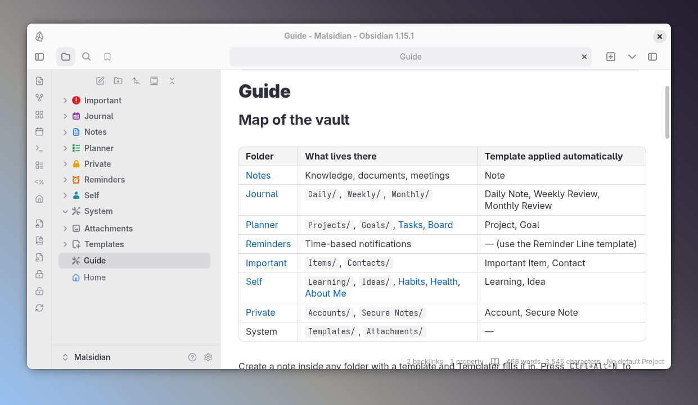
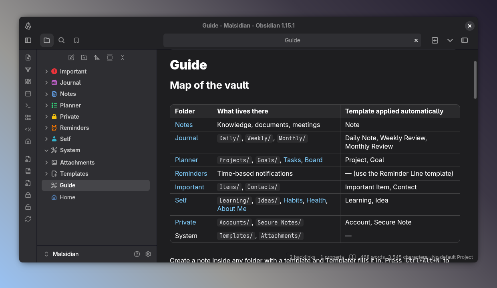
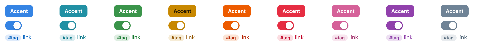

<p align="center">

</p>

# Obsiwaita

A GTK4 / libadwaita theme for Obsidian. Colors, radii, switches, menus and window controls follow libadwaita 1.6+.



Based on [birneee/obsidian-adwaita](https://github.com/birneee/obsidian-adwaita), with an improved theme, reworked into a modular source tree with a dedicated build step.

## Preview

| Light | Dark |
| --- | --- |
|  |  |

GNOME accent colors:



## Installation

Download the latest release from the [Releases page](https://github.com/Malvin555/Obsiwaita), then extract the theme files into your Obsidian vault.

After extracting, enable **Obsiwaita** from **Settings → Appearance → Themes**.

## Manual Install

Build, then copy the output into your vault:

```sh
npm install
npm run build
mkdir -p <vault>/.obsidian/themes/Obsiwaita
cp dist/theme.css dist/manifest.json <vault>/.obsidian/themes/Obsiwaita/
```

Then pick **Obsiwaita** under Settings, Appearance, Themes.

`dist/snippets/` holds two optional CSS snippets: `explorer-icons.css` (folder and file icons in the explorer) and `vault-layout.css` (page layout classes used by the companion vault). Copy them to `<vault>/.obsidian/snippets/` and enable them in Appearance.

## Develop

```sh
npm run dev          # rebuild on change
```
